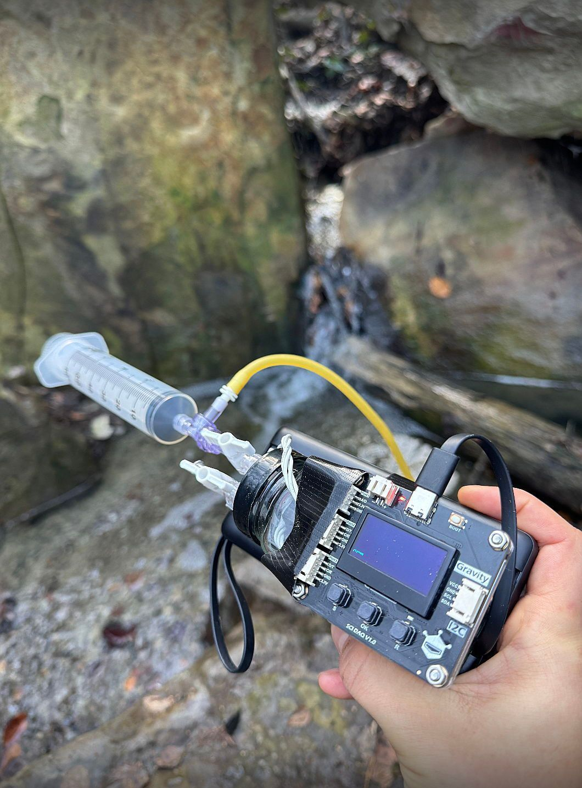

# 2FP Methane Sensor

**A practical build and measurement guide for the Winsen MH-Z9041A methane sensor, DFRobot Gravity SEN0654 breakout, and SCI DAQ logger.**

Read methane on the display, record time-stamped measurements, and export CSV files to Excel without writing code. An optional Arduino example is included for custom serial logging.

<p align="center">
  
</p>

*Bench assembly supplied by the project team. The photo documents the physical arrangement; chamber volume, seals, and sampling performance still need to be recorded and validated.*

[Setup](#setup-with-sci-daq-no-code) · [Specifications](#sensor-specifications) · [Arduino](#optional-arduino-logging) · [Data](#record-and-organize-a-run) · [Troubleshooting](#troubleshooting) · [Sources](docs/sources.md)

## What is here

This repository collects the hardware information shared by James Henriksen on November 3, 2026, manufacturer documentation checked on November 6, 2026, project photographs, and a repeatable starting workflow. It contains no experimental results yet. Hardware operation and the included sketch have not been tested by this repository's author.

The recommended path is:

```text
Methane sensor → Gravity I2C connection → SCI DAQ display and storage
                                                    ↓ USB-C
                                                CSV → Excel
```

The sensor reports **%LEL**. Keep that unit with every reading. A reading of 10 %LEL does not mean 10% methane by volume. The listed range starts at 3 %LEL; this is not a demonstrated instrument for measuring trace atmospheric methane.

## Hardware and budget

| Part | Identifier | Quantity | Reference price (USD) |
| --- | --- | ---: | ---: |
| [Gravity methane sensor breakout](https://www.dfrobot.com/product-2973.html) | SEN0654; Winsen MH-Z9041A sensing module | 1 | $69.00 |
| [Gravity SCI DAQ module](https://www.dfrobot.com/product-2655.html) | DFR0999 | 1 | $39.90 |
| Compatible four-pin Gravity cable | Double-ended PH2.0-4P for SCI DAQ connection; check included cables | 1 | Check package |
| USB-C data cable and appropriate power source | Data-capable cable required for file export | 1 | Additional |
| RTC backup battery | CR1220; check whether supplied | 1 | Additional |
| Chamber, syringe, valves, tubing, fittings, and mounting | Project-specific parts visible in photographs | As needed | Not yet itemized |

**Sensor + logger reference subtotal: $108.90**, excluding shipping, tax, chamber materials, and accessories. Prices are from the supplied note and matched the linked product pages when checked. Confirm before ordering. The pasted `DFR0999x 1` is interpreted as SKU DFR0999, quantity one.

The bare Winsen module and the Gravity breakout are different hardware layers. Follow Gravity instructions for SEN0654; do not infer bare-module wiring from this guide.

## Setup with SCI DAQ (no code)

### 1. Check the kit

Identify the SEN0654 sensor board and DFR0999 logger. Inspect the connectors, cable, and sensor for damage or moisture. Keep the sensor gas access unobstructed. Use the [official methane hookup diagram](https://wiki.dfrobot.com/sen0654/docs/16752) when identifying connectors.

### 2. Check firmware before connecting the sensor

On the SCI DAQ, open **S → Version**. DFRobot's methane tutorial requires **V1.0.5 or later**. Record the installed version in the run record. James's note says methane support is included in newer SCI DAQ firmware; the official minimum version provides the concrete compatibility check.

If an update is needed:

1. Copy existing CSV files to your computer first.
2. Obtain the appropriate `.uf2` from the [official SCI DAQ firmware folder](https://github.com/DFRobot/DFRobot_RP2040_SCI/tree/master/resources/firmware).
3. Power off the logger. Hold **Boot**, connect USB-C to the computer, then release Boot when the `RPI-RP2` drive appears.
4. Copy the firmware file to `RPI-RP2` and allow the board to restart.
5. Follow the [official update guide](https://wiki.dfrobot.com/dfr0999/docs/21430) for first-use formatting of the `U` storage drive. Formatting erases its contents; verify the selected drive and backup first.
6. Recheck the version and clock after updating.

Do firmware updates between experiments, with archived data safely copied elsewhere.

### 3. Connect and power up

With power disconnected, set the sensor's communication switch to **I2C**. Connect the sensor to an SCI DAQ **I2C input, port 2 or 3**, using the compatible four-pin cable. Match connector labels and polarity to the official diagram; do not rely on wire colors. The logger's controller-facing I2C output is a different connection.

Power the logger through USB-C with a suitable source. The module should recognize the sensor. Allow **at least 15 seconds** for the specified sensor warm-up, then observe whether readings settle under the actual sampling conditions. This warm-up is separate from the time needed to exchange gas in a chamber or tube.

### 4. Configure time and recording

Use **S → Set System Time** to check the clock, **Set Refresh Rate** to choose the interval, and **Set REC Content** to enable the connected sensor port. Record the time zone separately because a logger timestamp may not include it. A **1-second interval is a suggested starting point**, not a validated protocol; the sensor's T90 is specified as less than 15 seconds, so rapidly logged rows are not independent instantaneous responses.

Install the CR1220 RTC backup battery according to the logger guide if needed. Confirm that the clock survives a power cycle before collecting time-critical data.

### 5. Start, stop, and export

Press **R** to start or pause recording. The logger creates a CSV named from its clock when starting a new recording; holding R for approximately three seconds creates a new file. Check the display to confirm recording has started.

After a short trial, pause recording, connect USB-C to the computer, and copy CSV files from the logger's storage drive. Open the copied file and confirm timestamps, columns, units, and expected duration before beginning a longer experiment. The [SCI DAQ reference](https://wiki.dfrobot.com/dfr0999/docs/21424) documents these controls; menu labels can vary with firmware.

For Excel, use **Data → From Text/CSV** if double-clicking the file misreads dates or decimal separators. Preserve the original CSV unchanged and do analysis on a copy.

## Record and organize a run

1. Copy [templates/run-record.md](templates/run-record.md) into your experiment notes and complete the hardware, firmware, clock, sample, and environmental fields.
2. Record an initial observation under your chosen reference conditions. An ordinary air reading is a baseline observation, not a calibration certificate or proof of trace sensitivity.
3. Record sample introduction, valve changes, mixing, and any disturbances with timestamps. Define a stability criterion before comparing samples.
4. Export the original logger file into `data/raw/<run-id>/`. Retain the original filename and keep a second backup outside the logger.
5. Put cleaned tables and plots in `data/processed/<run-id>/`, documenting exclusions and transformations.
6. Link the run record to its CSV files and setup photos. Flag warm-up, sensor errors, out-of-range readings, and unstable periods instead of silently deleting them.

See [data/README.md](data/README.md) for naming and data-handling conventions. [templates/measurements.csv](templates/measurements.csv) provides an optional normalized table header; it is **not** a claim about the logger's native export format.

## Sensor specifications

The following specifications were supplied by James Henriksen and match the [SEN0654 product listing](https://www.dfrobot.com/product-2973.html) when checked. They describe vendor specifications, not measurements made by this project.

| Property | Specification |
| --- | --- |
| Sensing module | MH-Z9041A |
| Manufacturer | Zhengzhou Winsen Electronics Technology Co., Ltd |
| Target gas | Methane (CH₄) |
| Detection range | 3–100 %LEL |
| Warm-up | 15 s |
| Response | T90 < 15 s |
| Resolution | 0.1 %LEL |
| Accuracy at 25 °C, 5–20 %LEL | ±2 %LEL |
| Accuracy at 25 °C, 20–75 %LEL | ±3 %LEL |
| Accuracy at 25 °C, 75–100 %LEL | ±5 %LEL |
| Operating temperature | −13 to +58 °C |
| Operating humidity | 0–95% RH, noncondensing |
| Operating pressure | 80–115 kPa |
| Listed lifespan | >10 years |

Vendor accuracy bands meet at 20 and 75 %LEL as published. No accuracy is specified here for 3–5 %LEL or for conditions other than the stated accuracy conditions. Resolution is not accuracy; extra displayed decimal places do not improve measurement performance. The lifespan claim does not establish calibration stability for a particular unit.

Manufacturer address supplied in the note: **NO.299, Jinsuo Road, National Hi-Tech Zone, Zhengzhou 450001, China**. Website: [Winsen](https://www.winsen-sensor.com/).

## Interpreting methane readings

%LEL expresses concentration relative to the lower explosive limit reference used by the instrument. Before converting to ppm or volume percent, confirm that reference with the manufacturer for the actual device/firmware and record it with the calculation. This repository deliberately leaves that reference unspecified.

If the confirmed reference is `L` percent methane by volume and the measured value is `R` %LEL:

```text
methane (% by volume) = (R / 100) × L
methane (ppm by volume) = (R / 100) × L × 10,000
```

The quoted ±2 %LEL accuracy is an absolute interval in the reported unit, not ±2% of each reading. A gas concentration alone also does not establish a methane production rate or flux: those require a defined volume or flow, time basis, and an appropriate sampling model.

Use an approved laboratory procedure for methane handling and certified equipment wherever a safety alarm or hazardous-area rating is required. No such certification is established by this repo. Keep liquid and condensation out of the sensor; the pictured chamber is not documented as pressure-rated.

## Optional Arduino logging

The SCI DAQ workflow above requires no Arduino code. For a direct sensor-to-Arduino connection, see [examples/arduino](examples/arduino/README.md) and the included [CSV sketch](examples/arduino/methane_serial_csv/methane_serial_csv.ino).

Install the **DFRobot_MHZ9041A** library in Arduino IDE, wire the Gravity breakout for I2C following the official Arduino tutorial, select the board and port, and upload the example. Open Serial Monitor at **115200 baud**. The sketch writes elapsed milliseconds, methane in %LEL, sensor-reported temperature, and a fault code. Elapsed milliseconds are not wall-clock timestamps. The sketch has not been compiled or hardware-tested here.

For programming a controller connected *through SCI DAQ*, use the separate [DFRobot_RP2040_SCI library](https://github.com/DFRobot/DFRobot_RP2040_SCI). Its API is distinct from the direct methane library. Upstream driver code and firmware remain in their vendor repositories.

## Project photographs

<p align="center">
  
</p>

*Field view supplied by the project team. The photo does not establish gas composition, sampling location, or measurement validity.*

See [images/README.md](images/README.md) for original filenames and a list of useful follow-up photographs. Before using the pictured chamber as a repeatable method, document internal gas volume, wetted materials, leak checks, gas path, mixing, sampling volume, and equilibration time. These details cannot be recovered reliably from the photos alone.

## Troubleshooting

| Symptom | Checks |
| --- | --- |
| Sensor not recognized | Confirm firmware ≥V1.0.5, sensor I2C switch, correct logger input, connector polarity, and power. Power down before reseating. |
| Blank display or repeated restart | Check supply and cable, then disconnect the sensor to isolate a connection or power issue. |
| No storage drive on computer | Use a data-capable USB cable and another port; check whether the device is in normal mode or Boot mode. |
| CSV missing or empty | Confirm R recording state, REC Content selection, and available storage; make and export a short trial file. |
| Wrong time | Set clock, verify RTC battery orientation, and record time zone. |
| Unexpectedly low reading | Check units, range, warm-up, chamber leaks, gas exchange, and whether the sample is below the specified range. |
| Slow response | Separate sensor T90 from tubing transit, chamber mixing, and sampling delays. |
| Fault code or implausible readings | Save the code, check environmental limits and moisture, and consult the upstream driver/vendor. Do not treat faulted values as valid measurements. |

## Repository map

```text
README.md                              Main setup and measurement guide
CHANGELOG.md                           Project changes
COPYRIGHT.md                           Attribution and reuse status
docs/sources.md                        Source links and verification notes
images/                                Supplied bench and field photographs
examples/arduino/                      Optional direct-I2C logging sketch
templates/run-record.md                 Copy for each experiment
templates/measurements.csv              Optional normalized table header
data/raw/                              Original logger exports
data/processed/                        Derived data and figures
```

To track your own changes locally:

```bash
cd /home/braden/GitHub/2FP_methane_sensor
git status
git add README.md docs images templates examples data
git commit -m "Document sensor setup and measurements"
```

GitHub repository: [two-frontiers-project/2FP_methane_sensor](https://github.com/two-frontiers-project/2FP_methane_sensor). Clone it with `git clone https://github.com/two-frontiers-project/2FP_methane_sensor.git`. Original documentation and photos have no open-source license assigned yet; see [COPYRIGHT.md](COPYRIGHT.md). Vendor libraries retain their own licenses.
